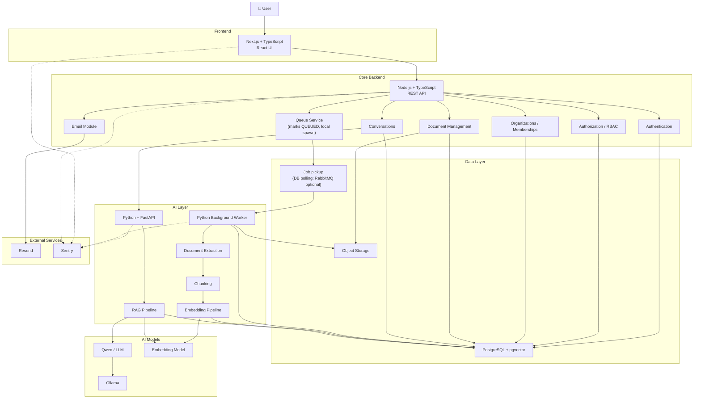

# AI Knowledge Platform

> A multi-tenant AI-powered knowledge platform that helps organizations transform large collections of documents into searchable, grounded, and actionable knowledge.

🌐 **Live Production App:** [https://ai-powered-workspace.vercel.app](https://ai-powered-workspace.vercel.app)  
⚙️ **Production API (HTTPS):** [https://3-25-255-191.sslip.io/api/v1](https://3-25-255-191.sslip.io/api/v1)

---

## 📌 Overview

Organizations often have large amounts of information stored across old documents, reports, policies, spreadsheets, presentations, and other records.

The problem is not always a lack of information — it is the difficulty of **finding, understanding, and using the information that already exists**.

This project aims to solve that problem by providing an organization-based platform where teams can:

* Create and manage organizations
* Invite team members
* Assign roles and permissions
* Upload organizational documents
* Process documents asynchronously
* Extract and organize their content
* Search organizational knowledge using AI
* Ask questions about uploaded knowledge
* Receive answers grounded in the organization's documents
* View the sources used to generate an answer

The system is designed as a **multi-tenant SaaS application**, meaning multiple organizations can use the same platform while their data remains strictly isolated.

---

# 🎯 Problem Statement

Companies can accumulate large amounts of valuable information in:

* PDFs
* Word documents
* Excel spreadsheets
* PowerPoint presentations
* Text files
* Historical records
* Internal documentation

Over time, this creates several problems:

1. Valuable organizational knowledge becomes difficult to find.
2. Employees spend significant time manually searching documents.
3. Important information can effectively become "lost" inside old records.
4. Employees may not know which document contains the information they need.
5. Reading and analyzing large numbers of documents manually is inefficient.
6. Traditional keyword search may not understand the meaning behind a question.
7. AI-generated answers can hallucinate if they are not grounded in trusted organizational knowledge.

This application aims to provide a centralized system where organizations can upload their knowledge and interact with it through an AI-powered retrieval system.

---

# 💡 Solution

The platform combines:

```text
Document Storage
        +
Document Processing
        +
Embeddings
        +
Vector Search
        +
Retrieval-Augmented Generation (RAG)
        +
Access Control
        +
Multi-Tenant Architecture
```

When a document is uploaded, it is processed asynchronously.

Its content is extracted, normalized, divided into smaller chunks, converted into embeddings, and stored for semantic retrieval.

When a user asks a question, the system retrieves relevant knowledge from the user's authorized organizational data and provides that context to an LLM.

The answer is therefore generated from the organization's stored knowledge rather than relying only on the model's general knowledge.

---

# 👥 Target Users

The primary target users are organizations and companies that maintain significant amounts of internal documentation and historical records.

Potential use cases include:

* Internal company knowledge
* Policies and procedures
* Historical records
* Technical documentation
* Research documents
* Project documentation
* Operational records
* Employee knowledge bases
* Compliance documentation
* Business reports

---

# ✨ Core Features

## 1. Authentication

Users can:

* Register using email and password. The email address is verified **before** the account is created: the user requests a verification link, opens it, and then sets their name and password. The account is created already verified and the user is signed in automatically.
* Accept an organization invitation and register in one step (the invitation link proves ownership of the email address)
* Log in
* Log out
* Reset their password

---

## 2. Organizations

A user can create an organization.

An organization acts as a tenant boundary for:

* Members
* Roles
* Documents
* Projects
* Conversations
* Knowledge

A user can belong to multiple organizations, each with a different role.

---

## 3. Team Management

Organization owners can:

* Invite users
* Assign roles
* Remove members

Administrators can manage permissions according to the organization's authorization rules.

Each organization has exactly one owner.

---

## 4. Role-Based Access Control

The platform uses role-based access control (RBAC).

Organization roles:

```text
OWNER  — full control over the organization and all its resources
ADMIN  — manages membership; does not automatically control every project
MEMBER — regular user with access to authorized resources
```

Project roles:

```text
PROJECT_MANAGER — manages project membership and project resources
PROJECT_MEMBER  — regular access to project resources
```

The important principles are:

> Users can only perform actions that their role and organization membership allow.

> An organization must always have at least one ADMIN.

> A project must always have at least one PROJECT_MANAGER.

---

## 5. Organization Isolation

Data belonging to one organization must never be accessible to another organization.

For example:

```text
Organization A
├── Members
├── Documents
├── Projects
├── Conversations
└── Knowledge

Organization B
├── Members
├── Documents
├── Projects
├── Conversations
└── Knowledge
```

Organization A must never retrieve or access Organization B's data.

This isolation applies to:

* Database queries
* Documents
* Document chunks
* Embeddings
* Vector searches
* Conversations
* AI retrieval

---

## 6. Document Upload & Multimodal Vision

Supported document and raster image formats:

```text
PDF (.pdf)
DOCX (.docx)
XLSX (.xlsx)
TXT (.txt)
PPTX (.pptx)
Images: PNG (.png), JPG/JPEG (.jpg, .jpeg, .jfif), WEBP (.webp), BMP (.bmp), TIFF (.tiff, .tif), GIF (.gif)
```

Images, infographics, system architecture flowcharts, and diagrams are processed using **Multimodal AI Vision OCR** (`gemini-3.6-flash` with fallback sequence across `gemini-3-flash-preview` and `gemini-flash-lite-latest`), transcribing visual hierarchies and tables directly into structured Markdown for semantic chunking and RAG retrieval.

---

## 7. Projects / Departments

Documents are organized into projects (also called departments) within an organization.

```text
Organization
├── HR
├── Finance
├── Engineering
└── Legal
```

A user can belong to multiple projects. Project membership is separate from organization membership.

An organization ADMIN does not automatically have project-management authority over every project.

---

## 8. Groups

Groups provide efficient bulk access control.

Instead of creating individual permission rules for hundreds of users, groups allow:

```text
Document
  → Group Access Rule
    → Group
      → Group Members
```

Example groups: "Executive Team", "HR Leadership", "Finance Team".

A group belongs to one organization and can only contain members of that organization.

---

## 9. Document Access Control

Documents have two access modes:

```text
PROJECT    — accessible to all authorized project members
RESTRICTED — subject to additional per-user / group / role rules
```

For restricted documents, access rules can be based on:

* Individual user
* Group
* Organization role
* Project role

**DENY has the highest precedence.** If any DENY rule matches, the user is denied even if an ALLOW rule also exists.

---

## 10. Document Versioning

Documents support multiple versions. Historical versions are preserved.

This allows the system to answer questions such as:

> "Previously this was X, but now it has changed to Y."

RAG provenance identifies which version supported an answer.

---

## 11. Audit Logging

Audit logging is part of the V1 design.

Audit logs are:

* Append-only (no updates or deletes)
* Organization-scoped

Captured events include: member invited, member removed, role changed, document uploaded, document deleted, permissions changed, and other important security operations.

---

## 12. Duplicate Document Detection

The system prevents unnecessary duplicate uploads.

A document that is identical to an already uploaded document should not be processed again unnecessarily.

Duplicate detection is based on content hash — not just filename.

Modified documents with the same filename are allowed as a new version.

---

# 📄 Document Processing Pipeline

Document processing is asynchronous so that large files do not block the main API request.

```text
User
 │
 ▼
Next.js
 │
 ▼
Node.js Backend
 │
 ├── Authenticate
 ├── Authorize
 ├── Validate document
 └── Store document
        │
        ├──────────────► Object Storage
        │
        └──────────────► PostgreSQL
                              │
                              ▼
                      document_versions
                      (status = QUEUED)
                              │
                              ▼
                       Python Worker
                   (polls the DB every 3 s;
                    RabbitMQ is optional)
                              │
                    ┌─────────┴─────────┐
                    ▼                   ▼
             Extract Content        Metadata
                    │
                    ▼
              Normalize Content
                    │
                    ▼
                 Chunking
                    │
                    ▼
             Embedding Model
                    │
                    ▼
            PostgreSQL + pgvector
                    │
                    ▼
                  READY
```

---

# 📊 Document Processing Status

Documents will follow a lifecycle similar to:

```text
UPLOADED
    ↓
QUEUED
    ↓
PROCESSING
    ↓
READY
```

If processing fails:

```text
PROCESSING
    ↓
FAILED
```

Background jobs are processed independently from the user's HTTP request: the API leaves the version `QUEUED` and the worker picks it up (see *Background Job Processing*).

---

# 🤖 AI & RAG

The AI system uses Retrieval-Augmented Generation (RAG).

The basic process is:

```text
User Question
      ↓
Question Embedding
      ↓
Vector Similarity Search
      ↓
Relevant Document Chunks
      ↓
Build Context
      ↓
LLM
      ↓
Grounded Answer
      ↓
Sources
```

The AI should not blindly answer based on its general knowledge when organizational knowledge is required.

Instead, the system should retrieve relevant authorized information and provide that information to the LLM as context.

---

# 🔍 Retrieval Security

Retrieval is subject to organization and access-control boundaries.

Conceptually:

```text
Question
   ↓
Identify User
   ↓
Identify Organization
   ↓
Check Access
   ↓
Search Authorized Knowledge
   ↓
Generate Answer
```

A vector similarity search must never simply search every vector in the database.

It must be restricted according to the user's authorized scope.

For example:

```text
organization_id = current_organization_id
```

and, where applicable:

```text
project_id = current_project_id
```

This is one of the most important security requirements of the system.

---

# 🧠 Initial AI Model Strategy

> **Current status:** production uses the **Google Gemini API** (`gemini-3.6-flash` for generation and vision, `gemini-embedding-001` for 768-dim embeddings). The Ollama/Qwen code is kept **commented out** as a reference for running models locally (see "AI provider configuration" below).

The original plan was to start with **free/local AI models** to minimize development cost:

```text
Runtime: Ollama
LLM:     Qwen
```

That plan was superseded by the Gemini provider; the abstraction below is what made the switch possible.

The architecture should keep model access behind an abstraction so that models can be replaced later.

For example:

```text
                    AI Model Interface
                           │
             ┌─────────────┴─────────────┐
             ▼                           ▼
       Local Qwen                    Cloud LLM
       (Development)                (Future)
```

---

# 🗄️ Data Architecture

The primary database is:

```text
PostgreSQL
```

Vector search will initially be handled using:

```text
pgvector
```

This allows relational application data and vector embeddings to coexist within PostgreSQL.

Conceptually:

```text
PostgreSQL
│
├── Users
├── Organizations
├── Memberships
├── Roles
├── Invitations
├── Projects
├── Documents
├── Conversations
├── Messages
├── Document Chunks
└── Embeddings
```

The final schema and relationships will be defined in the database-design phase.

---

# 📦 Object Storage

Original uploaded files should not be stored directly inside PostgreSQL.

Instead, the system uses object storage.

## Development

```text
MinIO
```

MinIO provides S3-compatible object storage locally.

## Production

```text
AWS S3
```

The application should communicate through a storage abstraction so that development storage can be replaced with AWS S3 without rewriting the business logic.

Conceptually:

```text
Development

Application
    ↓
Storage Interface
    ↓
MinIO


Production

Application
    ↓
Storage Interface
    ↓
AWS S3
```

---

# 📨 Background Job Processing

Document processing is asynchronous. **As built**, the flow is:

```text
Node.js Backend
      │
      │ Commit document_versions row with status = QUEUED
      ▼
PostgreSQL
      │
      │ Worker DB poller (every 3 s) claims the oldest QUEUED row
      ▼
Python Worker
```

RabbitMQ was the original design (a Node publisher and a Python consumer). Only the **consumer** was built, it is optional, and nothing publishes to it (see DEC-003 and DEC-035 in `docs/decision-log.md`).

If RabbitMQ publishing is added in the future, a queue message should contain a reference such as:

```json
{
  "job_type": "PROCESS_DOCUMENT",
  "document_id": "document-id"
}
```

The actual document file should remain in object storage rather than being placed inside the queue message.

> **Current implementation note:** the worker discovers jobs in two ways, and both are safe to run together because the QUEUED → PROCESSING transition is a single atomic `UPDATE`:
>
> 1. **Database poller (primary in the Docker / EC2 deployment).** `apps/worker` polls `document_versions` every 3 seconds for the oldest `QUEUED` version (skipping suspended organizations) and processes it.
> 2. **RabbitMQ consumer (optional).** Started alongside the poller; it only connects when `RABBITMQ_URL` is configured.
>
> The API does not publish to RabbitMQ today. In local development it spawns the worker's `src.process_job` as a child process; in Docker it leaves the version `QUEUED` for the worker service. A recovery sweep in the API marks versions stuck in `PROCESSING` for more than 20 minutes as `FAILED`.

---

# 🐍 Python AI Service

The AI service is separated from the core Node.js backend.

Technology:

```text
Python
FastAPI
```

Its responsibilities are:

* Embedding generation for questions (`POST /api/v1/embeddings`)
* LLM interaction / answer generation (`POST /api/v1/llm/chat`)
* Provider abstraction (Gemini, Ollama reference, mock)
* A utility chunking endpoint (`POST /api/v1/utils/chunk`)
* RAG orchestration and SSE streaming (`POST /api/v1/rag/query`, `/rag/stream`): implemented, but **not currently called** by the API or the web app

Document processing (extraction, normalization, chunking, embedding of documents) lives in the **Python worker**, not in this service.

> **Current implementation note:** the permission-aware vector search for chat runs in the **Node.js API** (`apps/api/src/modules/conversations/rag.repository.ts`), which calls this service only to embed the question and to generate the answer. A second copy of the same search exists in `apps/ai-service/src/db.py` for its `/rag/*` endpoints. If the access rules change, update both (or remove one).

The AI service does not own the core SaaS business rules.

---

# ⚙️ Python Background Worker

The Python worker handles long-running processing tasks.

For example:

```text
PROCESS_DOCUMENT
REPROCESS_DOCUMENT
DELETE_DOCUMENT_VECTORS
```

In the current implementation the worker finds work by polling `document_versions` for `QUEUED` rows (and, optionally, by consuming RabbitMQ). Only document processing is implemented: a failed document is retried through `POST /documents/:id/reprocess`, which re-queues it, and vectors are removed by database cascade when a document is deleted (there is no separate `DELETE_DOCUMENT_VECTORS` job).

A successful run saves the chunks and marks the version `READY` in one transaction; a failed run marks it `FAILED`.

---

# 🌐 Backend Architecture

The core backend is built with:

```text
Node.js
TypeScript
```

It acts as the primary business API.

Major backend modules include:

```text
backend/
│
├── auth/
├── users/
├── organizations/
├── memberships/
├── invitations/
├── roles/
├── permissions/
├── projects/
├── documents/
├── conversations/
├── messages/
├── storage/
├── queue/
├── email/
└── monitoring/
```

These are modular boundaries inside the core backend rather than unnecessary independently deployed microservices.

---

# 🔐 Security Architecture

Security is treated as a core architectural requirement.

## Authentication

Authentication answers:

> Who is this user?

---

## Authorization

Authorization answers:

> Is this user allowed to perform this action?

The backend is the final authority for authorization.

The frontend must never be trusted simply because it hides or displays a UI element.

For example:

```text
DELETE /documents/:id
        ↓
Authenticate
        ↓
Check Organization
        ↓
Check Membership
        ↓
Check Permission
        ↓
Allow / Reject
```

---

# 🔒 Multi-Tenant Security

The platform follows a tenant-isolation model.

Every organization-owned resource should be associated with an organization.

Conceptually:

```text
Organization
     │
     ├── Members
     ├── Projects
     ├── Documents
     ├── Conversations
     └── Knowledge
```

Requests must be scoped to the active organization.

This prevents accidental cross-organization data access.

---

# 📧 Email

Transactional email supports multiple dispatch providers via a unified `EmailService`:

```text
Nodemailer (Gmail SMTP) — Default zero-cost, zero-domain provider (up to 500 emails/day)
Resend — Modern transactional email API for verified custom domains
Console Mock — Graceful development fallback when keys are unconfigured
```

Supported email types:

```text
Email Verification (pre-registration link and resend)
Organization Invitation
Password Reset
Important Account Notifications
```

The email provider is abstracted cleanly through `apps/api/src/modules/email/email.service.ts` rather than being scattered throughout business logic.

---

# 📈 Monitoring & Observability

The initial monitoring solution is:

```text
Sentry
```

Sentry will be integrated with:

```text
Next.js
Node.js Backend
Python FastAPI Service
Python Worker
```

The goal is to track:

* Application errors
* Exceptions
* Performance issues
* Distributed request traces
* Background job failures

External uptime monitoring such as Better Stack can be added later if required.

---

# 🏗️ Complete Architecture



---

# 🔄 End-to-End User Flow

## Document Upload

```text
User
 ↓
Next.js
 ↓
Node.js API
 ↓
Authentication
 ↓
Authorization
 ↓
Document Validation
 ↓
Duplicate Check
 ↓
Object Storage
 ↓
PostgreSQL (version = QUEUED)
 ↓
Worker DB poller
 ↓
Python Worker
 ↓
Extract
 ↓
Normalize
 ↓
Chunk
 ↓
Embed
 ↓
pgvector
 ↓
READY
```

---

## Question Answering

```text
User
 ↓
Next.js
 ↓
Node.js API
 ↓
Authentication
 ↓
Authorization
 ↓
Authorized Project Scope (Node.js API)
 ↓
Question Embedding (Node.js API → Python AI Service → Gemini)
 ↓
pgvector Search with Org / Project / Access Filters (Node.js API)
 ↓
Context Builder (Node.js API)
 ↓
LLM (Node.js API → Python AI Service → Gemini)
 ↓
Grounded Answer + Sources saved (PostgreSQL)
 ↓
Next.js
 ↓
User
```

---

# 🧩 Project Structure

Current monorepo layout:

```text
AI Powered Workspace/
│
├── apps/
│   ├── web/                 Next.js + TypeScript frontend
│   ├── api/                 Node.js + Express + TypeScript core backend
│   │   └── src/modules/     auth, organizations, projects, groups, documents,
│   │                        conversations, invitations, email, queue, storage
│   ├── ai-service/          Python + FastAPI (real-time RAG, embeddings, LLM)
│   │   └── src/providers/   gemini.py (default), ollama.py (local reference), mock.py
│   └── worker/              Python background worker (document processing)
│       └── src/embeddings/  gemini.py (default), ollama.py (local reference), mock.py
│
├── docs/                    architecture/, decision-log.md, ...
├── ERD/
├── project-status.md
├── pyproject.toml
└── README.md
```

### AI provider configuration

The AI provider is selected per service via `.env`; **Google Gemini API is the active cloud provider**. Local Ollama code is preserved in commented form in each service as an educational code overview for running local models:

| Service | Variable | Value | Notes |
| ------- | -------- | ----- | ----- |
| `apps/api` | `AI_PROVIDER` | `ai-service` | Routes chat & RAG through FastAPI (`apps/ai-service`) running Gemini |
| `apps/ai-service` | `AI_PROVIDER` | `gemini` | Configured with `GEMINI_API_KEY`, `GEMINI_PRIMARY_MODEL` (`gemini-3.6-flash`), and `GEMINI_EMBEDDING_MODEL` (`gemini-embedding-001`) |
| `apps/worker` | `EMBEDDING_PROVIDER` | `gemini` | Configured with `GEMINI_API_KEY`, `GEMINI_EMBEDDING_MODEL`; vectors match ai-service in 768 dimensions |

> **Note on Local AI:** To run models locally instead of cloud Gemini, refer to the step-by-step instructions and uncommented templates in `apps/ai-service/src/providers/ollama.py`, `apps/worker/src/embeddings/ollama.py`, and `apps/api/src/modules/conversations/ai-client.ts`.

Embeddings are requested at 768 dimensions, so the `vector(768)` schema is unchanged. Re-embed existing chunks after switching providers (`python -m src.batch_embedder` in `apps/worker`, after clearing old embeddings).

---

# 🛠️ Technology Stack

| Layer             | Technology                          |
| ----------------- | ----------------------------------- |
| Frontend          | Next.js + TypeScript                |
| UI Components     | React + Tailwind CSS v4 (hand-written components in `components/ui`) |
| State Management  | Zustand (data fetching via a custom `apiClient`) |
| Core Backend      | Node.js + TypeScript (Express.js)   |
| AI Backend        | Python + FastAPI                    |
| Background Worker | Python                              |
| Database          | PostgreSQL                          |
| Vector Search     | pgvector (PostgreSQL extension)     |
| Object Storage    | MinIO (Local Dev Only) → AWS S3 (Production standard) |
| AI Provider       | Google Gemini API (Production default); Ollama for local dev |
| LLM               | gemini-3.6-flash (Production); qwen2.5 via Ollama (Local dev) |
| Embeddings        | gemini-embedding-001 (Production, 768-dim); nomic-embed-text via Ollama (Local dev) |
| Email             | Nodemailer (Gmail SMTP) / Resend    |
| Monitoring        | Sentry                              |
| Containerization  | Docker + Docker Compose             |
| Version Control   | Git + GitHub                        |

---

# 🐳 Local Development

The development environment is designed to minimize cost.

Infrastructure can run locally using Docker:

```text
Docker
│
├── PostgreSQL + pgvector
├── RabbitMQ (optional)
└── MinIO
```

Application services:

```text
Next.js
Node.js
Python FastAPI
Python Worker
```

Local AI models can run through:

```text
Ollama
```

This allows most of the application to be developed without depending on paid cloud services.

---

# 💰 Cost Strategy: Development vs. Production

The architecture strictly separates zero-cost local development tooling from production cloud infrastructure:

### Local Development (Zero Infrastructure Cost)
```text
Local PostgreSQL (or Neon Serverless free tier) with pgvector
Local RabbitMQ message broker (optional; not required by the current worker)
MinIO (S3-compatible local emulator — strictly for development)
Ollama (Local CPU model runner — strictly for development & offline testing)
Free-tier / mock email fallbacks
```

### Production Cloud Architecture
```text
AWS S3 (Standard production cloud object storage)
Google Gemini API (gemini-3.6-flash for generation + gemini-embedding-001 for 768-dim embeddings)
Neon Serverless PostgreSQL (with pgvector & PgBouncer pooling)
Managed RabbitMQ (CloudAMQP / AWS MQ): optional, not used by the current deployment
Sentry error tracking & performance monitoring
```

The unified `@aws-sdk/client-s3` and pluggable AI provider abstractions ensure zero code changes are required when switching between local dev (MinIO/Ollama) and production (AWS S3/Gemini API).

---

# 📋 Current Development Status

### ✅ Implementation — Complete

* [x] **Product Idea & Requirements**: Concept defined, target users, problem statement, full functional requirements (`docs/requirements/functional-requirements.md`).
* [x] **Architecture & Database Design**: System architecture diagrams, ERD (20 tables, 6 enums), component matrix, security and tenant isolation principles.
* [x] **PostgreSQL Schema & pgvector**: Relational schema with constraints, foreign keys, and a `vector(768)` HNSW cosine index (the worker creates the extension/index on startup). **Note:** the base DDL is not saved in the repo; only migrations 001–003 are. See *Known Gaps*.
* [x] **Node.js Backend Foundation (Phase 3)**: Express 5, TypeScript ESM, connection pooling, AppError hierarchy, Pino logging, Sentry monitoring, BaseRepository.
* [x] **Authentication & User Management (Phase 4)**: Pre-registration email verification (`email_verifications` table, migration 003) with automatic sign-in after registration, bcrypt, login, JWT dual-token rotation, password reset, logout.
* [x] **Organization Management (Phase 5)**: Multi-tenant CRUD, roles (`OWNER`, `ADMIN`, `MEMBER`), tenant isolation middleware, atomic ownership transfer.
* [x] **Members & Invitations (Phase 6)**: Invite member, role assignment, accept/reject token flows, one-step accept-and-register for new users, ADMIN minimum count enforcement, Nodemailer (Gmail SMTP) & Resend email dispatch.
* [x] **Project Management (Phase 7)**: Project CRUD, project membership, PROJECT_MANAGER minimum count rule, member self-removal.
* [x] **Group Management (Phase 8)**: Group CRUD, memberships, group-based document access rule integration.
* [x] **Document Upload & Storage (Phase 9)**: Multipart upload, 50MB file size limit, PDF/DOCX/XLSX/PPTX/TXT format validation, project-scoped SHA-256 deduplication, MinIO & AWS S3 object storage driver.
* [x] **Asynchronous Document Processing Worker (Phase 10)**: Python worker (`apps/worker`), optional RabbitMQ consumer with DLQ, DB-polling job pickup, format extractors, NFKC text normalizer, sliding-window chunker, thread-safe connection pooling.
* [x] **Embedding Pipeline (Phase 11)**: Pluggable embedding clients (Gemini API `gemini-embedding-001`, Ollama `nomic-embed-text`, deterministic Mock), batch embedding, pgvector HNSW indexing, standalone batch embedder tool.
* [x] **RAG & Conversations (Phase 12)**: Multi-turn conversations, XML prompt isolation, grounded answer generation, `FR-AI-005` insufficient-information fallback, citation provenance tracking in single DB transactions.
* [x] **Document Access Control (Phase 13)**: `PROJECT` vs `RESTRICTED` mode, user/group/org-role/project-role access rules with strict `DENY` precedence, 6-step evaluation pipeline, DB-level vector search filtering.
* [x] **Python AI Service (Phase 14)**: FastAPI microservice (`apps/ai-service`), asyncpg connection pooling, embeddings and LLM-completion endpoints (used by the API), `/rag/query` and SSE `/rag/stream` endpoints (implemented, not currently called by the app), Gemini and Ollama providers, internal auth token.
* [x] **Next.js Frontend (Phase 15)**: Next.js 16 App Router, dark-mode design system with Tailwind CSS v4, full auth views, organization switcher, project & document management, drag-and-drop upload with status polling, granular access rule dialog, AI chat (single-response, non-streaming) with a thinking indicator, and off-canvas source citation drawer.
* [x] **Audit Logging (Phase 16)**: Immutable PostgreSQL append-only audit log, non-fatal event dispatch across all system mutations, protected OWNER/ADMIN endpoints, interactive frontend audit log inspector.
* [x] **Platform Owner Dashboard & Tenant Governance**: Dedicated `/admin` interface for product owners to monitor cross-organization telemetry, suspend or reactivate organizations violating compliance/terms, with air-gapped CLI provisioning (`npm run platform-admin`) and zero-knowledge privacy protection (no access to customer files or conversations).
* [x] **Multimodal AI Vision & Image RAG Pipeline**: End-to-end ingestion and extraction for raster images (PNG, JPG, WEBP, BMP, TIFF, GIF) with in-memory normalization, multimodal Gemini Vision OCR (`gemini-3.6-flash` with fallback sequence), flowchart/architecture diagram transcription into structured Markdown, client-side thumbnail previews, and dedicated violet `ImageIcon` source citation drawer badges.
* [x] **Post-Phase 16 Hardening, UI/UX Polish & Cloud Readiness**:
  - Gemini API default provider (`gemini-3.6-flash`, `gemini-embedding-001`) with local Ollama fallback.
  - Neon Serverless PostgreSQL support with pgvector connection pooling.
  - In-memory fixed-window IP rate limiter (`rate-limit.middleware.ts`) on credential routes.
  - Interactive Help Center (`/help`), User Account Settings (`/settings/account`), Invitation Acceptance flow (`/invitations/accept`).
  - Contextual "Your Access" card, email verification banner, empty org view, accessible dialogs, and normalized API client.
  - Reconnect resilience for the RabbitMQ consumer and S3 storage error recovery.
* [x] **35 architectural decisions confirmed and documented** (see `docs/decision-log.md`).

### 🛠️ Latest Updates (2026-10-08)

* [x] **Phase 17 — Deployment & Dockerization**: Docker Compose stack (API, AI service, worker), AWS EC2 + Caddy SSL, Vercel frontend, GitHub Actions CI/CD. See `project-status.md`.
* [x] **Pre-registration email verification and auto-login** (`POST /api/v1/auth/register/initiate` → verify link → `POST /api/v1/auth/register`), plus `POST /api/v1/invitations/accept-and-register`.
* [x] **Stabilization pass**: worker DB poller no longer leaves documents stuck in `PROCESSING`; document sizes render correctly; open-redirect hardening on post-login redirects; invitation tokens are no longer returned to the inviter; invitation rejection is atomic; verification tokens are unique per request; API trusts one proxy hop in production so rate limits are per client.

### ⚠️ Known Gaps & Documentation Notes (as of 2026-10-09)

* **Base schema is not in the repo.** Only `apps/api/migrations/001–003` exist. Export the live schema (`pg_dump --schema-only`) and commit it (for example as `000_base_schema.sql`) so the database can be rebuilt.
* **No RabbitMQ publisher.** The API never publishes jobs; the worker discovers work by DB polling (DEC-035). The optional consumer and DLQ code is unused in production.
* **Chat retrieval lives in the Node API**, not in the AI service. `/rag/query` and `/rag/stream` exist in `apps/ai-service` but nothing calls them, and the web chat does not stream.
* **Authorization SQL is duplicated** in `apps/api/src/modules/conversations/rag.repository.ts` and `apps/ai-service/src/db.py`. They have already drifted (the Python copy also requires the organization to be `ACTIVE`).
* **Similarity threshold:** the value that matters for chat is the API's `RAG_SIMILARITY_THRESHOLD` (code default `0.35`; the `.env.example` files use `0.45`). The ai-service has its own threshold (its example uses `0.6`) that only affects its unused `/rag/*` endpoints.
* **Frontend stack:** there is no React Query and no shadcn/ui library; UI primitives are hand-written.
* **CI/CD** deploys with rsync + `docker compose up` and a health check; it does not run tests.

### 🔮 Future Phases

* [ ] **Phase 18 — Testing Suite Expansion** (End-to-end integration test suites across full microservices stack).
* [ ] **Phase 19 — Security Hardening** (Secrets manager integration, distributed Redis rate limiting, security headers audit).
* [ ] **Phase 20 — Production Monitoring & Observability** (Centralized log aggregation, distributed tracing dashboards).


---

# 🚀 Future Improvements

The initial architecture intentionally leaves room for future capabilities.

Potential future features include:

* User-facing document version management (upload new versions; design already in schema)
* Additional document formats (e.g. audio transcripts, markdown import)
* Advanced organization permissions & fine-grained team spaces
* Multiple organizations per user
* Advanced search & hybrid BM25 + dense vector ranking
* Knowledge collections & workspace tagging
* AI-generated summaries & key takeaways
* Automatic document classification
* Document comparison & diff analysis
* Usage analytics & tenant token metering
* Billing and subscriptions (Stripe integration)
* Usage limits & tier quotas
* Enterprise SSO (SAML / Okta)
* Advanced observability & distributed OpenTelemetry tracing
* Dedicated vector database when scale requires it (e.g., Qdrant / Pinecone)

The architecture should evolve incrementally rather than prematurely introducing unnecessary complexity.

---

# 🧠 Engineering Philosophy

This project is being built not only as a SaaS product but also as a practical engineering learning project.

The goal is to gain hands-on experience with:

```text
Software Engineering
        +
Full-Stack Development
        +
Backend Engineering
        +
Database Design
        +
System Design
        +
AI Engineering
        +
RAG
        +
Cloud
        +
Deployment
        +
Security
        +
Observability
```

The project prioritizes:

* Clear architecture
* Separation of responsibilities
* Security
* Maintainability
* Testability
* Scalability
* Practical engineering decisions
* Minimal unnecessary complexity

---

# 📚 Documentation

Detailed engineering documentation is maintained under `/docs`.

```text
docs/
│
├── product/
│   └── product-idea.md             — Product concept, users, problem, MVP definition
│
├── requirements/
│   └── functional-requirements.md  — Full functional requirements (FR-AUTH-*, FR-ORG-*, etc.)
│
├── architecture/
│   ├── architecture.md             — Architecture overview + component matrix
│   ├── system-architecture.md      — Detailed Mermaid diagrams (original)
│   ├── database.md                 — Database model (all 20 tables, columns, constraints)
│   ├── authorization.md            — Authorization model (roles, rules, DENY precedence)
│   └── rag.md                      — RAG system design (processing + retrieval pipeline)
│
└── decision-log.md                 — All 35 confirmed architectural/product decisions
```

Also at the root:

```text
project-status.md   — Central progress tracker (completed, next, future, TODOs, conflicts)
ERD/                — Entity Relationship Diagram (PNG + PDF)
```

Architecture decisions document not only **what** technology was selected, but also **why** it was selected.

---

# ⚠️ Security Notice

Never commit secrets to this repository.

Do not commit:

```text
.env
.env.production
API keys
AWS credentials
Database passwords
JWT secrets
Private keys
Service account credentials
LLM API keys
```

Instead, provide:

```text
.env.example
```

containing placeholder values.

---

# 📄 License

License details will be added when the project reaches the appropriate stage.

---

# 👨‍💻 Project Status

This project has completed **all phases (Phases 1 through 17 + Platform Owner Dashboard & Governance)** and is **fully deployed and operational in production**.

**OAuth social login and Sentry production monitoring will be implemented in the future.**

The system has been developed and deployed incrementally:

```text
✅ Product Idea & Requirements
      ↓
✅ System Architecture & Database Design (ERD complete)
      ↓
✅ PostgreSQL Schema Implementation (20 tables, 6 enums)
      ↓
✅ Node.js Backend Foundation & Security
      ↓
✅ Authentication & User Management (JWT rotation, password reset)
      ↓
✅ Organization Management (Multi-tenant CRUD, roles, transfer)
      ↓
✅ Member & Invitation Management (Invitations, tokens, Nodemailer/Resend email)
      ↓
✅ Project Management (CRUD, memberships, PM minimum rule)
      ↓
✅ Group Management (CRUD, memberships, group project roles)
      ↓
✅ Document Upload & Object Storage (50MB cap, MinIO/S3, deduplication)
      ↓
✅ Asynchronous Document Processing Worker (Extractors, chunker, DB-polling pickup, optional RabbitMQ consumer)
      ↓
✅ Embedding Pipeline & Vector Storage (pgvector, Gemini & Ollama clients)
      ↓
✅ RAG Pipeline & AI Conversations (Grounded answers, XML prompt, citations)
      ↓
✅ Document Access Control (RESTRICTED mode, DENY precedence, DB vector filter)
      ↓
✅ Python FastAPI AI Service (Embeddings, LLM completion, multi-provider; RAG/SSE endpoints implemented but unused)
      ↓
✅ Next.js 16 Frontend (App Router, Tailwind v4, Chat, Citations, UI polish)
      ↓
✅ Audit Logging (Append-only PostgreSQL log, UI viewer)
      ↓
✅ Platform Owner Dashboard & Tenant Governance (Lockout, Privacy guarantee)
      ↓
✅ Production Containerization & CI/CD Deployment (Phase 17 - Vercel + AWS EC2 + Caddy SSL + GitHub Actions)
```

See [project-status.md](project-status.md) for the full progress tracker, open TODOs, and upcoming milestones.

See [docs/decision-log.md](docs/decision-log.md) for all 35 confirmed architectural and product decisions.


The objective is to build the system end-to-end while maintaining production-oriented engineering practices throughout the development process.

