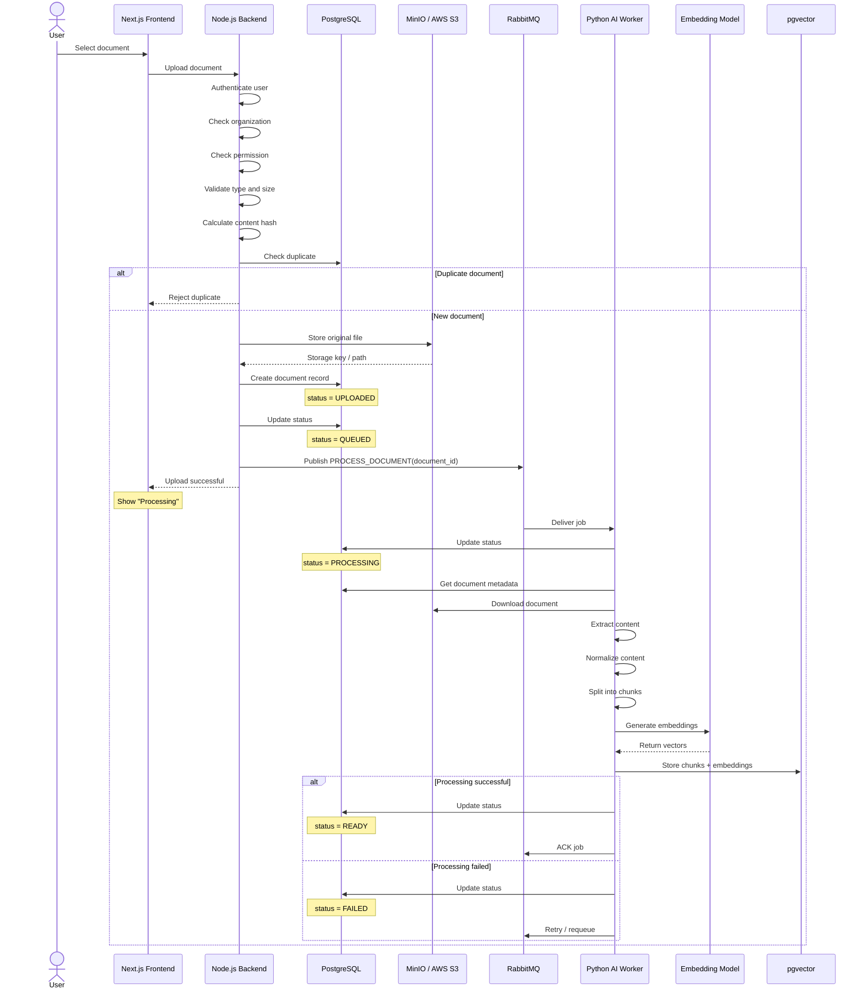
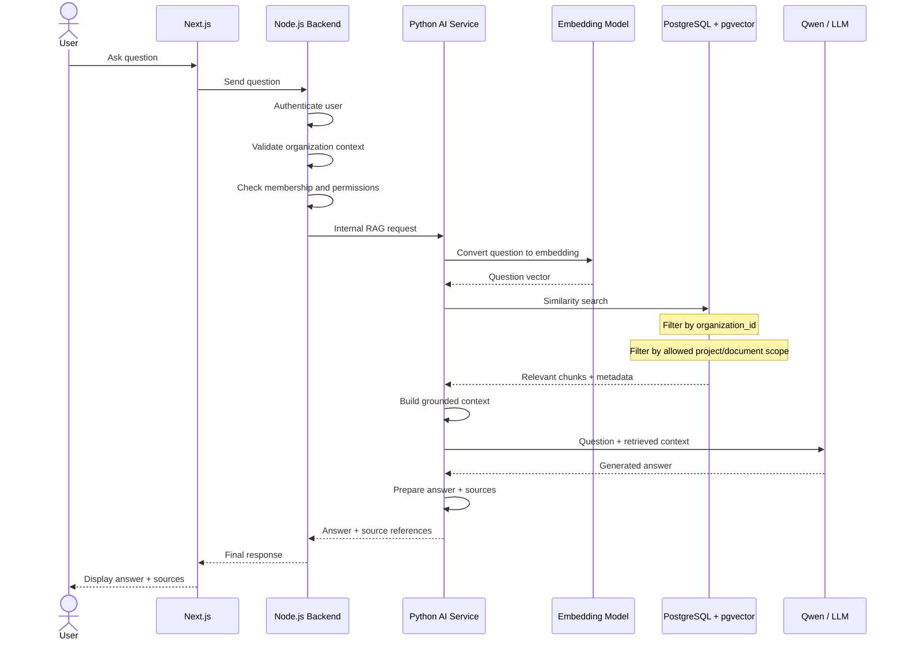

# Complete System Architecture

> **Architecture Style:** Modular SaaS + Separate AI Service
> **Primary Goal:** Build a production-style multi-tenant AI knowledge platform while gaining hands-on experience with full-stack development, backend engineering, AI/RAG, cloud, queues, databases, security, monitoring, and deployment.

## 1. High-Level Architecture

```mermaid
flowchart TB

    %% ============================================================
    %% USERS
    %% ============================================================

    USER["👤 User"]

    %% ============================================================
    %% FRONTEND
    %% ============================================================

    subgraph FRONTEND["🌐 FRONTEND APPLICATION"]
        NEXT["Next.js + TypeScript<br/>React UI<br/>Dashboard<br/>Organizations<br/>Documents<br/>Chat"]
    end

    %% ============================================================
    %% CORE BACKEND
    %% ============================================================

    subgraph BACKEND["⚙️ CORE BACKEND - Node.js + TypeScript"]
        API["REST API"]

        AUTH["Authentication"]
        RBAC["Authorization & RBAC"]
        ORG["Organizations & Memberships"]
        INVITE["Invitations"]
        DOC["Document Management"]
        CHAT["Conversation Management"]
        EMAIL["Email Module"]
        JOB["Job Publisher"]
        OBS["Structured Logging<br/>Tracing Context"]

        API --> AUTH
        API --> RBAC
        API --> ORG
        API --> INVITE
        API --> DOC
        API --> CHAT
        API --> EMAIL
        API --> JOB
        API --> OBS
    end

    %% ============================================================
    %% AI SERVICE
    %% ============================================================

    subgraph AI["🤖 PYTHON AI SERVICE"]
        FASTAPI["FastAPI<br/>Internal AI API"]

        RAG["RAG Orchestrator"]
        RETRIEVAL["Retrieval Service"]
        PROMPT["Prompt & Context Builder"]
        SOURCES["Source / Citation Builder"]

        FASTAPI --> RAG
        RAG --> RETRIEVAL
        RAG --> PROMPT
        RAG --> SOURCES
    end

    %% ============================================================
    %% AI WORKER
    %% ============================================================

    subgraph WORKER["⚙️ PYTHON BACKGROUND WORKER"]
        CONSUMER["RabbitMQ Consumer"]
        PROCESSOR["Document Processor"]

        EXTRACT["Content Extraction"]
        NORMALIZE["Content Normalization"]
        CHUNK["Chunking"]
        EMBED["Embedding Pipeline"]

        CONSUMER --> PROCESSOR
        PROCESSOR --> EXTRACT
        EXTRACT --> NORMALIZE
        NORMALIZE --> CHUNK
        CHUNK --> EMBED
    end

    %% ============================================================
    %% INFRASTRUCTURE
    %% ============================================================

    subgraph DATA["🗄️ DATA & INFRASTRUCTURE"]

        POSTGRES["PostgreSQL + pgvector<br/><br/>Users<br/>Organizations<br/>Memberships<br/>Roles<br/>Invitations<br/>Documents Metadata<br/>Processing Status<br/>Conversations<br/>Messages<br/>Chunks + Embeddings"]

        RABBIT["RabbitMQ<br/><br/>PROCESS_DOCUMENT<br/>REPROCESS_DOCUMENT<br/>DELETE_DOCUMENT_VECTORS"]

        STORAGE["Object Storage<br/><br/>Development Only: MinIO<br/>Production: AWS S3"]

    end

    %% ============================================================
    %% AI MODELS
    %% ============================================================

    subgraph MODELS["🧠 AI MODELS"]

        EMBEDDING_MODEL["Embedding Model (768-dim)<br/><br/>Production: Google Gemini API<br/>Development: Local Ollama"]

        LLM["LLM (Grounded Generation)<br/><br/>Production: Google Gemini API (gemini-3.8-flash)<br/>Development: Local Ollama (qwen2.5)"]

    end

    %% ============================================================
    %% EXTERNAL SERVICES
    %% ============================================================

    subgraph EXTERNAL["☁️ EXTERNAL SERVICES"]

        GEMINI["Google Gemini API<br/>Primary Production AI Provider"]

        RESEND["Nodemailer (Gmail SMTP) / Resend<br/>Transactional Email"]

        SENTRY["Sentry<br/>Errors<br/>Performance<br/>Tracing"]

        OLLAMA["Ollama<br/>Local Dev Model Runtime"]

    end

    %% ============================================================
    %% USER REQUEST FLOW
    %% ============================================================

    USER -->|"HTTPS"| NEXT
    NEXT -->|"HTTPS / REST API"| API

    %% ============================================================
    %% BACKEND DATA ACCESS
    %% ============================================================

    AUTH --> POSTGRES
    RBAC --> POSTGRES
    ORG --> POSTGRES
    INVITE --> POSTGRES
    DOC --> POSTGRES
    CHAT --> POSTGRES

    %% ============================================================
    %% DOCUMENT UPLOAD FLOW
    %% ============================================================

    DOC -->|"Store original document"| STORAGE
    DOC -->|"Create document metadata"| POSTGRES

    JOB -->|"Publish job"| RABBIT
    RABBIT -->|"Deliver job"| CONSUMER

    %% ============================================================
    %% WORKER PROCESSING FLOW
    %% ============================================================

    PROCESSOR -->|"Get document metadata"| POSTGRES
    PROCESSOR -->|"Download original file"| STORAGE

    EMBED -->|"Generate vectors"| EMBEDDING_MODEL
    EMBEDDING_MODEL --> OLLAMA

    EMBED -->|"Store chunks + vectors"| POSTGRES
    PROCESSOR -->|"PROCESSING / READY / FAILED"| POSTGRES

    %% ============================================================
    %% RAG / QUESTION FLOW
    %% ============================================================

    CHAT -->|"Internal request"| FASTAPI

    RETRIEVAL -->|"Question embedding"| EMBEDDING_MODEL
    RETRIEVAL -->|"Vector similarity search + tenant filters"| POSTGRES

    PROMPT -->|"Grounded context"| LLM
    LLM --> OLLAMA

    FASTAPI -->|"Answer + sources"| CHAT

    %% ============================================================
    %% EMAIL
    %% ============================================================

    EMAIL -->|"Verification / Invitations / Reset Password"| RESEND

    %% ============================================================
    %% MONITORING
    %% ============================================================

    NEXT -.->|"Errors / Performance"| SENTRY
    API -.->|"Errors / Traces"| SENTRY
    FASTAPI -.->|"Errors / Traces"| SENTRY
    PROCESSOR -.->|"Errors / Job Failures"| SENTRY
```



---

# 2. Document Upload and Processing Flow



---

# 3. RAG Question and Answer Flow



---

# 4. Security and Multi-Tenant Isolation

Every request follows this security chain:

```text
User
  ↓
Authentication
  ↓
Identify User ID
  ↓
Identify Active Organization
  ↓
Check Membership
  ↓
Check Role / Permission
  ↓
Access Requested Resource
```

## Critical Multi-Tenant Rule

Every organization-owned resource must be isolated by organization.

Conceptually:

```text
Document Request
      ↓
Validate:

document.id = requested_document_id
AND
document.organization_id = active_organization_id
```

Vector retrieval must also be isolated:

```text
Find similar document chunks

WHERE
organization_id = active_organization_id
AND
document is accessible to the current user
```

**A similarity search without tenant filtering is never allowed.**

---

# 5. Component Responsibility Matrix

| Component           | Technology           | Primary Responsibility                |
| ------------------- | -------------------- | ------------------------------------- |
| Frontend            | Next.js + TypeScript | User interface and user experience    |
| Core API            | Node.js + TypeScript | SaaS business logic, authorization, rate limiting |
| AI API              | Python + FastAPI     | Real-time RAG orchestration, SSE streaming |
| AI Worker           | Python               | Asynchronous document processing      |
| Relational Database | PostgreSQL (Local / Neon Serverless) | Core application data                 |
| Vector Store        | pgvector             | 768-dim embeddings and similarity search |
| Job Queue           | RabbitMQ             | Reliable background job delivery      |
| Object Storage      | MinIO (Local Dev Only) → AWS S3 (Production) | Original uploaded documents           |
| Embedding Runtime   | Google Gemini API default (`gemini-embedding-001`, 768-dim); Ollama for local dev | Text-to-vector conversion (768-dim)   |
| LLM Runtime         | Google Gemini API default (`gemini-3.8-flash`); Ollama for local dev | Grounded answer generation and streaming |
| Email               | Nodemailer (Gmail SMTP) / Resend | Transactional emails                  |
| Monitoring          | Sentry               | Errors, performance, and tracing      |

---

# 6. Final Deployment Boundary

```text
PUBLIC INTERNET
│
├── Next.js Frontend
│
└── Node.js Backend API
        │
        │ Internal / Controlled Communication
        ▼
    ┌─────────────────────────────┐
    │ PRIVATE APPLICATION LAYER   │
    │                             │
    │  Python AI API              │
    │  Python AI Worker           │
    │  RabbitMQ                   │
    │  PostgreSQL + pgvector      │
    │  Object Storage             │
    │  Ollama / AI Runtime        │
    └─────────────────────────────┘

EXTERNAL MANAGED SERVICES
│
├── Resend
├── Sentry
└── AWS S3 (Production)
```

---

# 7. Final Architecture Principles

1. **Frontend never directly accesses the database, queue, or AI secrets.**
2. **Node.js backend owns authentication, authorization, organizations, and SaaS business rules.**
3. **Python owns AI-specific processing and RAG responsibilities.**
4. **Long-running document processing always happens asynchronously.**
5. **RabbitMQ messages contain references such as `document_id`, not the actual file.**
6. **Original files live in object storage, not PostgreSQL.**
7. **PostgreSQL stores relational data, metadata, document chunks, and vectors through pgvector.**
8. **Every tenant-owned resource must be scoped by `organization_id`.**
9. **Vector search must always apply organization and access filters.**
10. **The AI should answer from retrieved knowledge and return source references.**
11. **The worker is responsible for processing status transitions and retry-aware job execution.**
12. **Development infrastructure should run locally with Docker where practical.**
13. **Production infrastructure can be swapped independently without rewriting core business logic.**
14. **Monitoring and error tracking are part of the architecture from the beginning.**
15. **The system starts as a small number of well-defined deployable applications, not dozens of unnecessary microservices.**

---

# Final Architecture Summary

```text
Next.js Frontend
        │
        ▼
Node.js Core Backend
        │
        ├──────────────► PostgreSQL + pgvector
        │
        ├──────────────► Object Storage
        │
        ├──────────────► RabbitMQ ──────► Python AI Worker
        │                                      │
        │                                      ├── Extract
        │                                      ├── Normalize
        │                                      ├── Chunk
        │                                      └── Embed
        │
        ├──────────────► Python FastAPI AI Service
        │                       │
        │                       ├── Retrieve
        │                       ├── RAG
        │                       └── LLM
        │
        └──────────────► Nodemailer / Resend

All Applications
        │
        └──────────────► Sentry
```
